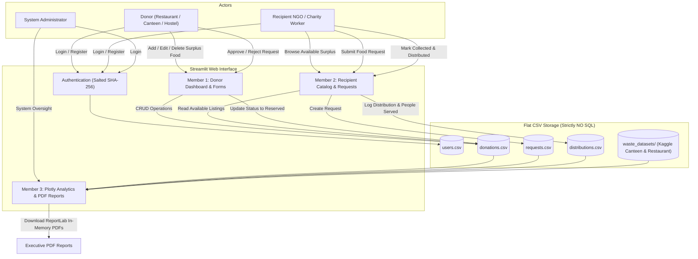

<div align="center">

# 🍲 Food Waste Management and Redistribution
### B.Tech CSE (AI) — Semester 3 Academic Project (Batch B17)
**An Intelligent Operational Redistribution & Data Analytics Platform**

[](https://www.python.org/)
[](https://streamlit.io/)
[](https://pandas.pydata.org/)
[](https://plotly.com/)
[](https://www.reportlab.com/)
[](https://sdgs.un.org/goals/goal2)
[](https://github.com/saikushwanth15/B17-Food-Waste-Management-and-Redistribution)

<p align="center">
  <b>Bridging institutional food surplus with local community hunger relief through real-time coordination, verifiable distributions, and data-driven waste intelligence.</b>
</p>

---

</div>

## 📑 Table of Contents
- [Problem Statement & Motivation](#-problem-statement--motivation)
- [UN SDG 2 Alignment (Zero Hunger)](#-un-sdg-2-alignment-zero-hunger)
- [Team Members & Division of Responsibilities](#-team-members--division-of-responsibilities)
- [System Architecture & Workflow](#-system-architecture--workflow)
- [Technology Stack](#-technology-stack)
- [Key Features by Role](#-key-features-by-role)
- [Historical Kaggle Datasets Integration](#-historical-kaggle-datasets-integration)
- [Installation & Local Setup](#-installation--local-setup)
- [Demo Credentials](#-demo-credentials)
- [Automated Testing Suite (23 Tests)](#-automated-testing-suite-23-tests)
- [Viva Evaluation & Key Technical Decisions](#-viva-evaluation--key-technical-decisions)

---

## 🎯 Problem Statement & Motivation
Every single day, restaurants, university canteens, catering services, supermarkets, and hostels prepare excess food that goes unconsumed. Simultaneously, orphanages, old-age homes, urban shelters, and economically vulnerable families face severe nutritional insecurity. 

The primary barrier is not food scarcity, but **information asymmetry and logistical coordination**:
1. Donors lack a friction-free, validated channel to list short-shelf-life surplus food before it spoils.
2. Verified NGOs struggle to locate nearby food surplus in time to arrange pickup and delivery.
3. Establishments lack operational intelligence to identify what categories of food are repeatedly wasted.

This project delivers an integrated Python web platform that digitizes surplus food donations, automates recipient request matching, tracks verified distributions with beneficiary headcounts, and generates statistical analytics dashboards and downloadable PDF reports.

---

## 🌍 UN SDG 2 Alignment: Zero Hunger
Our platform directly advances **United Nations Sustainable Development Goal 2 (Zero Hunger)**:
- **Target 2.1:** Ensure access by all people to safe, nutritious, and sufficient food all year round.
- **Target 12.3:** Halve per capita global food waste at retail and consumer levels and reduce food losses along production and supply chains.

By tracking the exact kilogram volume of food rescued ($771.3\text{ kg}$), meals delivered ($3,200\text{ meals}$), and beneficiaries served, the system converts unavoidable surplus into tangible community impact.

---

## 👥 Team Members & Division of Responsibilities

The project is structured into three specialized, non-overlapping engineering responsibilities:

| Member Name | Role & Project Responsibilities | Primary Source Files |
|:---|:---|:---|
| **N Thulasi Krishna** | **Member 1 – Streamlit Interface & Donor Management**<br/>• Web application base interface & session routing<br/>• Donor registration & login with salted SHA-256 hashing<br/>• Donor Dashboard with contribution KPIs and urgent expiry alerts<br/>• Add Donation form with multi-field validation (positive kg, future expiry)<br/>• Edit and safe cascading Delete for donation listings<br/>• Multi-attribute search, filter, and sort catalog | `app.py`<br/>`utils/auth.py`<br/>`modules/donor.py`<br/>`tests/test_donor.py` |
| **N Charya Vishwa** | **Member 2 – Recipient, Request & Distribution Tracking**<br/>• Recipient / NGO dashboard & community impact metrics<br/>• Available surplus food browsing catalog<br/>• Food request submission and donor approval/rejection workflows<br/>• Collection and distribution tracking (recording beneficiaries & locations)<br/>• Automatic donation expiration scheduler | `modules/recipient.py`<br/>`data/requests.csv`<br/>`data/distributions.csv` |
| **L Sai Kushwanth** | **Member 3 – Data Analytics, Visualization & PDF Reporting**<br/>• Pure Pandas data cleaning, deduplication, and type coercion engine<br/>• Key Performance Indicator (KPI) engine with zero-division safety<br/>• Interactive Plotly analytics dashboard (10 charts, trends, heatmaps)<br/>• Historical Kaggle canteen & restaurant waste dataset explorer<br/>• In-memory dynamic PDF report generation using ReportLab (`BytesIO`)<br/>• Automated unit test suite & semester viva evaluation documentation | `modules/analysis.py`<br/>`modules/analytics.py`<br/>`modules/reports.py`<br/>`tests/test_analytics.py` |

---

## 🏗️ System Architecture & Workflow



---

## 💻 Technology Stack

- **Core Programming Language:** Python 3.10+
- **Frontend / Application UI:** Streamlit 1.32+
- **Data Engineering & Analytics:** Pandas 2.0+
- **Interactive Visualizations:** Plotly Express & Plotly Graph Objects
- **Document Generation:** ReportLab 4.0+ (Dynamic vector canvas built in `io.BytesIO`)
- **Data Persistence:** Pure flat CSV files (`data/*.csv`)
  > **Strict Architectural Constraint:** In compliance with the project guidelines, **no SQL or relational database engine (SQLite, MySQL, PostgreSQL) is used**. All data persistence is handled via modular CSV file handling through `utils/storage.py`.

---

## 🌟 Key Features by Role

### 1. Donor Features (Member 1: N Thulasi Krishna)
- **Donor Dashboard:** Real-time metrics on total food listed, kg donated, meals delivered, and active listings.
- **Urgent Expiry Banner:** Proactively highlights active food listings that expire in $< 4\text{ hours}$.
- **Add Donation Form:** Multi-field validation ensuring food name $\ge 3$ characters, quantity $> 0\text{ kg}$, servings $\ge 1$, future expiration timestamp, dietary classification (Veg, Non-Veg, Vegan, Halal), and packaging type.
- **Full CRUD Management:** Edit available food details or safely delete listings (automatically cleans up associated pending requests).
- **Search & Filter Catalog:** Real-time search across food items, donor names, notes, categories, and cities.

### 2. Recipient / NGO Features (Member 2: N Charya Vishwa)
- **Surplus Food Catalog:** Live listing of edible surplus food tagged with location and freshness countdowns.
- **Request Coordination:** NGOs submit requests specifying logistical capabilities and estimated beneficiaries.
- **Approval & Reservation Workflow:** Donors approve requests, immediately transitioning the food to `Reserved` and auto-rejecting conflicting requests.
- **Distribution Tracking:** Records completed distributions, delivery timestamps, locations, and verified beneficiary headcounts.
- **Automatic Expiry Scheduler:** Food uncollected before its best-before timestamp automatically transitions to `Expired`.

### 3. Analytics & Reporting Features (Member 3: L Sai Kushwanth)
- **Executive KPI Engine:** Accurate metrics with zero-division safety: Total Food Listed ($1,479.2\text{ kg}$), Food Rescued ($771.3\text{ kg}$), Rescue Rate ($52.1\%$), Wastage Rate ($15.2\%$), and Average Response Time ($3.9\text{ hrs}$).
- **10 Interactive Plotly Charts:** Monthly trends, daily volume streams, category volume breakdowns, listed vs. rescued city comparisons, and a cross-tabulated City $\times$ Category heatmap.
- **Kaggle Waste Dataset Explorer:** Dynamic auto-detection and manual column overrides for university canteen and restaurant waste logs with automated data hygiene audits (duplicate dropping, missing imputation, negative filtering).
- **In-Memory PDF Generation:** Generates styled vector PDF reports on demand:
  1. *Operational Analytics Report* (KPI tables, vector charts, narrative findings).
  2. *Project Evaluation & Viva Defense Summary* (team breakdown, architecture, SDG goals).
  3. *Historical Waste Dataset Audit Report* (cleaning metrics, dispersion, peak waste).

---

## 🔬 Historical Kaggle Datasets Integration

The application integrates two real-world Kaggle datasets to benchmark waste drivers against operational donations:

1. **[Food Waste Dataset from a University Canteen](https://www.kaggle.com/datasets/rahuljangir78/food-waste-dataset-from-a-university-canteen)**
   - *Schema:* `Date`, `Meal_Type`, `Day_Of_Week`, `Students_Present`, `Food_Prepared_kg`, `Food_Wasted_kg`, `Food_Category`
   - *Analysis:* Meal-session waste patterns (Breakfast vs Lunch vs Dinner) and student turnout correlation.
2. **[Food Wastage Data in Restaurant](https://www.kaggle.com/datasets/trevinhannibal/food-wastage-data-in-restaurant)**
   - *Schema:* `Date`, `Dish_Category`, `Quantity_Prepared`, `Quantity_Sold`, `Wastage_kg`, `Wastage_Reason`, `Unit_Price`
   - *Analysis:* Economic losses, overproduction vs spoilage drivers, and high-waste dish categories.

> **Integrity Safeguard:** Historical Kaggle datasets are analyzed strictly in the **Historical Waste Datasets** tab (`data/waste_datasets/`) and are never combined with operational donation listings (`donations.csv`) to prevent conflating historical waste with food currently available for donation.

---

## 🚀 Installation & Local Setup (Windows PowerShell)

### Step 1: Clone the Repository
```powershell
git clone https://github.com/saikushwanth15/B17-Food-Waste-Management-and-Redistribution.git
cd B17-Food-Waste-Management-and-Redistribution
```

### Step 2: Create & Activate Virtual Environment
```powershell
python -m venv .venv
.venv\Scripts\Activate.ps1
```

### Step 3: Install Required Packages
```powershell
pip install -r requirements.txt
```

### Step 4: Populate Demonstration Records
```powershell
python seed_data.py
```
*(To reset the database back to clean demo data at any time, run `python seed_data.py --reset`).*

### Step 5: Run the Streamlit Application
```powershell
streamlit run app.py
```
The web application will open automatically in your browser at `http://localhost:8501`.

---

## 🔑 Demo Credentials

| Role | Email | Password | Access Capabilities |
|:---|:---|:---|:---|
| **System Administrator** | `admin@foodrescue.com` | `admin123` | Full administrative visibility, all donations, requests, and user audits |
| **Food Donor** | `spice@demo.com` | `demo123` | Add surplus food, view donor dashboard, manage incoming NGO requests |
| **NGO / Recipient** | `hope@demo.com` | `demo123` | Browse available food, request food, record distributions and people served |

*(New donors and NGOs can also register directly via the **Register** tab).*

---

## 🧪 Automated Testing Suite (32 Tests)

Our platform includes a comprehensive unit test suite covering input validation, mathematical KPI safety, Kaggle schema detection, and PDF generation.

To run the complete test suite:
```powershell
python -m unittest discover -s tests -v
```

### Test Coverage Summary:
- **Member 3 Analytics Suite (`tests/test_analytics.py` - 11 Tests):**
  - Division by zero and NaN edge cases in KPI calculations.
  - Mathematical accuracy of Rescue Rate (%) and Wastage Rate (%).
  - University Canteen and Restaurant schema auto-detection.
  - Data hygiene filter (dropping duplicate rows and negative waste quantities).
  - In-memory PDF synthesis and valid byte-stream generation.
- **Member 1 Donor Suite (`tests/test_donor.py` - 12 Tests):**
  - Form validation: rejection of short food names, negative quantities, zero servings, and past expiration times.
  - Search and filter logic: multi-attribute filtering, keyword search, and quantity sorting.
  - Authentication security: salted SHA-256 password hashing, regex email, and 10-digit Indian mobile validation.
- **Member 2 Recipient Suite (`tests/test_recipient.py` - 9 Tests):**
  - Distribution validation: headcount $\ge 1$ and location verification.
  - Surplus food catalog: only available items shown, search and sorting by urgency and quantity.
  - Request approval logic: automatic status update to `Reserved` and conflict auto-rejection of competing requests.
  - Automated donation expiration handling.

```text
Ran 32 tests in 0.339s
OK
```

---

## 🎓 Viva Evaluation & Key Technical Decisions

### 1. Why use flat CSV files instead of a SQL Database?
> **Answer:** *"The academic brief specifies a pure flat-file CSV architecture to test core Python concepts: file handling, dictionary manipulation, Pandas DataFrame transformation, and defensive programming. All CRUD operations are abstracted through `utils/storage.py`, demonstrating high modularity without relying on database engines."*

### 2. How is password security maintained without a database?
> **Answer:** *"Passwords are never stored in plain text. In `utils/auth.py`, each password is salted with a unique random token generated via `secrets.token_hex(8)` and hashed using SHA-256. Passwords are saved as `salt$hash` in `users.csv`, preventing rainbow-table attacks."*

### 3. How do you prevent memory leaks when users download PDF reports?
> **Answer:** *"In `modules/reports.py`, all ReportLab document stories are built inside Python's `io.BytesIO()` memory buffer and delivered directly as raw byte streams to Streamlit's `st.download_button`. No temporary PDF files are written to disk, preventing filesystem clutter and server memory leaks."*

### 4. How are conflicting NGO requests handled?
> **Answer:** *"When a donor approves an NGO's request for an available food item, the donation status immediately changes to `Reserved`. The system automatically rejects all other pending requests for that same donation record in `requests.csv`, preventing duplicate collections."*

---

## 📜 Ethical Conduct & Food Safety Notice
Redistributing surplus food requires strict food safety diligence:
- Donors must verify that surplus food was stored under hygienic conditions and provide accurate preparation timestamps.
- The application automatically moves food to `Expired` once the `expiry_datetime` is reached.
- Receiving NGOs must conduct physical and sensory inspection prior to community distribution.
